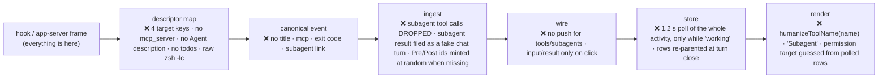
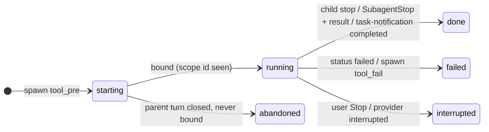
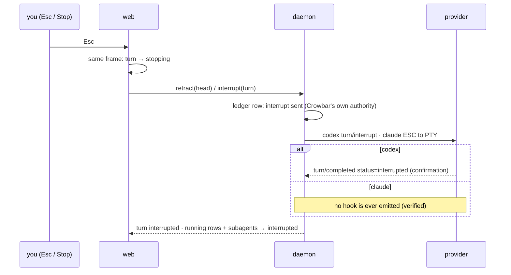

# Chat surface additions: showing what the agent is actually doing

_2026-10-17. Built on real hook captures from `claude` 2.1.302 and `codex` 0.158.0 (scratchpad
`design-surface.md`, `design-hooks/logs/`). It uses only hooks and YAML descriptors; nothing reads
provider internals. Reference UIs: T3 Code and Hermes desktop, both MIT, so they can be reused with
attribution. Claude Code's own TUI is the bar. This is the rendering half of
`2026-10-16-chat-surface-report.md`._

## TL;DR

- **The data is already arriving.** Every detail Claude Code's own UI shows reaches us in hooks Crowbar
  already receives, and the same goes for Codex's app-server:
  - the subagent's description;
  - the MCP server and tool;
  - Bash's own one-line description;
  - the parsed Codex command;
  - diffs, exit codes, todos and interrupt flags.
- **Crowbar loses that data in three places:**
  1. **The descriptors map too little.** Claude's target comes from only 4 keys, MCP names are never
     split, and todos are never registered.
  2. **The canonical model has no field for it.** There's no title, MCP server, subagent link or exit
     code.
  3. **The web never receives it live.** Tool rows are re-read by a 1.2 s poll, and only while the chat
     looks "working".
- **Subagents can't show what they're doing because of a deliberate choice.** Their tool calls are
  dropped on purpose (`ingest.go:184`), and a test enforces it.
- **"Tool call" is a fallback, not a label.** Rows show a humanized raw name ("Mcp echo shout",
  "Agent") with an empty subject.
- **The design:**
  - **Every row is "verb + concrete target"**, and the label is computed on the client from one
    canonical row.
  - **Exploration is grouped into one summary line; changes get their own row.** For example "Read 3
    files, searched 2 patterns" groups exploration. Edits, commands, subagents and approvals each
    get their own card.
  - **Subagents become cards** with a title, a type, a live "current action" taken from their own
    tool rows, a clock, tokens and the result.
  - **Todos become a strip above the composer.** The active item becomes the working line's label.
  - **Approvals sit above the composer** and show their own command, diff or MCP arguments.
- **Speed:** the prompt echo and the spinner appear in the **same frame as Enter**. A tool row appears
  **≤50 ms after its hook**, by push. The daemon replies to the HTTP hook as soon as the row is
  appended (≤5 ms), so Claude no longer waits on Crowbar's processing for every tool.
- **What it costs:**
  - About 15 new canonical fields and 3 new events, all mapped in YAML (no provider words in Go).
  - One stream of row operations to the client.
  - Adapting about 6 MIT reference components onto our Plate/base-ui kit. React-markdown is never
    used.

---

## 1. The bar: what Claude Code shows (captured in a real PTY)

```text
❯ find the test targets and tidy the readme
✶ Survey docs… (11s · ↓ 1.6k tokens)              ← active todo replaces the verb
  ⎿ ◼ Survey docs
    ◻ Summarize
⏺ Searched for 1 pattern, read 2 files, called echo (ctrl+o to expand)   ← exploration summarised
⏺ Update(README.md)
  ⎿ Updated README.md with 3 additions and 1 removal                     ← mutation itemised
⏺ Agent(Find Makefile test targets)                                      ← subagent titled by its description
  ⎿ Backgrounded agent
  ◯ general-purpose  Find Makefile test targets  2s · ↓ 28.0k tokens     ← live row per agent
✻ Waiting for 1 background agent to finish
  ⎿ Interrupted · What should Claude do instead?                         ← immediate, local
```

That comes down to six rules:
1. Never a bare tool name.
2. Exploration is summarized; changes are itemized.
3. One live line always says the most specific true thing: the active todo, then the running tool,
   then waiting on agents, then thinking.
4. A subagent has a title, a type, a clock, tokens and a live state.
5. The echo and the spinner appear on the Enter frame.
6. Interrupt shows immediately.

---

## 2. Where the detail is lost today



---

## 3. Data model additions

### 3.1 Canonical fields, mapped only in YAML

| Event | New fields |
|---|---|
| `tool_pre` / `tool_post` / `tool_fail` | `tool_title` (the agent's own description of the call), `mcp_server`, `mcp_tool`, `exit_code`, `interrupted`, `spawns_scope` (the subagent this call created), `addresses_scope` (Codex wait/close), `scope_id` (whose call: "" = main agent), `batch_id` |
| `subagent_pre` / `subagent_post` | `title`, `status`, `result`, `usage.{tokens, tool_uses, duration}` |
| `permission` | `tool_target`, `tool_input`, `mcp_server`, now carried **on the ask itself** |
| **new** `plan_step` | `scope_id, step_id, text, detail, status`: an incremental upsert (Claude's todo tools) |
| `plan_update` (kept) | a wholesale replace (Codex `turn/plan/updated`) |
| **new** `subagent_result` | `scope_id, status, result, usage.*`, from Claude's injected `<task-notification>` / `<agent-message>` and Codex's child `turn_stop` |
| **new** `tool_batch` (optional) | closes calls that never got Pre/Post (Claude's validation rejects) |

The descriptor grammar needs four generic extensions, none of them provider-specific:
1. **One canonical event fed by several wire events.** This already exists for `Notification`.
2. **A `pattern:` transform.** For example, `mcp_tool` from `mcp__server__tool`; the grammar already
   exists for the slash catalogue.
3. **A `json:` transform**, for Codex's JSON-encoded `spawn_agent` result.
4. **A composite `kind_map` key**, so Codex `collabAgentToolCall/spawnAgent` ≠ `…/wait`.

The full YAML sketches for `claude.yaml` and `codex.yaml` (both channels) are in the scratchpad
`design-surface.md` §5.1. Also delete the dead `features.collab_agents=true` line from `codex.yaml`,
since Codex 0.158 ignores it.

### 3.2 Rows and entities the client renders

```mermaid
classDiagram
  class Row {
    seq
    turnId (fixed at birth)
    scopeId ("" = main agent)
  }
  Row <|-- user_message
  Row <|-- assistant_text
  Row <|-- reasoning
  Row <|-- tool_call
  Row <|-- ask
  Row <|-- marker
  Row <|-- turn_error
  class tool_call {
    family: read|search|execute|edit|fetch|mcp|subagent|plan|meta|ask|other
    status
    title · target · mcp{server,tool}
    summary{lines, files, exit, +a/−r, firstErrorLine, argsSummary, firstResultLine}
    inputRef · resultRef (lazy)
  }
  class Subagent {
    scopeId · spawnToolId
    type · title · status
    started/ended · usage · result
    lastAction (derived, never stored)
  }
  class Plan {
    scopeId
    items[id, text, detail, status]
  }
  class Turn {
    id · status · started/ended · diff
  }
```

**Wire operations** are pushed per chat and numbered by `seq`:
- `row.add`, `row.patch`, `text.append`, `entity.upsert`, `plan.replace`, `plan.upsert`, `turn.patch`.
- They're applied idempotently: a duplicate `seq` is ignored, and a gap means `resync since=seq`.
- Every row carries its **summary fields**, so a collapsed row never needs a fetch. Full input and
  output stay lazy.

**Status vocabulary** everywhere: `pending → running ⇄ awaiting_approval → done | failed | declined | interrupted | abandoned`.

---

## 4. Element specs

### A. Tool rows, by family

The label is **computed on the client** from `{family, status, target, title, mcp, summary}` and
never stored twice.

| Family | Live | Settled | Inline extra | Expand |
|---|---|---|---|---|
| read | `Reading notes.ts L10–20` | `Read notes.ts · 42 lines` | muted dir | first ~40 lines, shiki, lazy |
| search | `Searching for "TODO"` | `Searched "TODO" · 7 files` | scope path | hit list |
| execute | `Running <title or program>` | `Ran <title or program>` (+ neutral `exit 1` chip) | `$ cmd` one line, live output tail | full stdout/stderr (ANSI) |
| edit | `Editing README.md` | `Edited README.md  +3 −1` | — | diff, **open by default when ≤12 lines changed** |
| fetch | `Fetching docs.rs` | `Fetched docs.rs/…` | — | excerpt |
| mcp | `echo · shout` (shimmer) | `echo · shout` | `text: "hi"` → `HI` | args JSON + result |
| subagent | → card C | | | |
| plan | **no row**; feeds the strip (D); at most one muted "Updated tasks" marker per turn | | | |
| meta | **hidden**: ToolSearch, SubagentHandback, TaskList, Codex wait/close (shown on the card), Crowbar's own `mcp__crowbar__*` as quiet markers ("Renamed chat to …") | | | |
| other | `<Humanized name>` + first scalar arg | | | raw JSON |

**Fallback chain, so "nothing" can never show:**
- **Title:** the agent's title, then the program name (unwrapping `bash -lc` / `sudo` / `env`, as in
  T3 `commandProgramName`), then the raw command.
- **Target:** the target, then the first scalar input value, then the humanized name.

**Grouping:**
- Consecutive read, search, fetch and read-only MCP rows in one turn form a **run**. While live it's
  one line: `Reading 2 files, searching 1 pattern…` with a ticker showing the newest call. Once
  settled it collapses to `Read 2 files, searched 1 pattern, called echo`.
- A run breaks at text, an edit, a failed command, a subagent or an ask.
- Edits, commands, subagents and asks are **cards** and are never folded (Hermes `tool-render-class`).
- **Optional turn fold:** once a turn is done, everything before the final text collapses to
  `Worked for 42s · 9 tool calls` (T3).

**Row states:**
- running: a spinner glyph, and only the verb shimmers (Hermes);
- failed: red glyph plus the first error line;
- declined: "Denied";
- interrupted: "Stopped";
- abandoned: amber "Result unavailable".

```text
✓ Read 2 files, searched "TODO", called echo                         ▸
● Running npm test                                    $ npm test   4s
  │ PASS src/a.test.ts
✓ Edited README.md  +3 −1                                            ▾
  │ - old line
  │ + new line
✗ Ran cat missing.txt   exit 1   cat: missing.txt: No such file
```

### B. MCP rows

- **The server is the main noun** (Claude Code: "Calling echo…"). Each server gets a badge coloured by
  its name, and Crowbar's own server gets the Crowbar glyph.
- **The args summary** is the first 1–2 scalar arguments as `key: value`, truncated. The **result
  summary** is the first text line.
- **Errors:** Claude's `isError` content, or Codex's `item.error`.
- **Claude's `ToolSearch` rows** come before the first use of every deferred tool or MCP tool. They
  map to `meta`, otherwise every MCP call shows two rows.

### C. Subagent card

```text
◐ Find Makefile test targets          general-purpose · 0:12 · 28k tok
  ▸ Reading Makefile                                                  ← current action (derived)
  ▾ 6 tool uses
    ✓ Searched "test:" · 3 files
    ✓ Read Makefile · 120 lines
  ─ Result ───────────────────────────────────────────────
  The test targets are `test`, `test-race` and `test-integration`…
```

**Identity.** A subagent's card has a single owner: the subagent entity, not the spawn tool row.

1. **Created on the spawning `tool_pre`** with status `starting`. Its title is Claude's Agent
   `description`, Codex's `prompt` (first line), or Codex-hooks' `message`. Its type is
   `subagent_type` or the model.
2. **Bound to its scope** by whichever arrives first:
   - Claude: `SubagentStart.agent_id` plus `PostToolUse(Agent).tool_response.agentId`;
   - Codex api: `spawnAgent item/completed.receiverThreadIds[0]`;
   - Codex hooks: `SubagentStart` or the decoded spawn result.

   A `SubagentStop` with no `Start` and an empty `agent_type` is a harness-internal agent, and is
   ignored.
3. **Every event carrying the scope becomes a nested row.** That's Claude's `agent_id` and Codex's
   child `threadId`. This replaces the deliberate drop and unifies the Claude and Codex paths.

Codex child frames can arrive before the bind (they landed in the same millisecond in the capture).
They are held in a bounded per-chat "unclaimed scope" buffer, drained on bind and dropped at turn
close. No timer.

**Lifecycle.** The card is independent of the spawn row and of the parent turn, because Claude's
subagents are async: the parent's `Stop` lists them under `background_tasks` while they're still
running.



**Rendering:**
- **Header:** title, type chip, status glyph and live clock. Once done it adds `· N tool uses · 12k
  tokens`.
- **Line 2:** `▸` plus the live label of the newest running child row, or the newest settled one, or
  "Thinking…". It's **computed from rows**, never stored (T3 `progress ?? ▸ lastToolName`, Hermes'
  ticker).
- **Expanded:** the nested rows (same components, indented, grouped), then the **result** as
  markdown. Claude's result is the first of `SubagentStop.last_assistant_message`, the injected
  `<result>`, or the hand-back body. Codex's is the child `turn_stop`.
- **Placement:** the card *replaces* the "Agent" tool row at that position. The composer shelf lists
  running agents with **title + current action + clock**.
- **The injected completion prompt is not a chat row.** That's `<task-notification>` /
  `<agent-message>`; it becomes `subagent_result`, which removes today's fake harness turn.
- **Codex `wait`/`close` never get rows of their own.** The card shows "Parent waiting…".

### D. Todos / plan

```text
╭───────────────────────────────────────────────────────────╮
│ ◼ Survey docs                                        2/5 ▾│   ← collapsed, docked above the composer
╰───────────────────────────────────────────────────────────╯
  ✔ Read the spec   ◼ Survey docs   ◻ Summarize   ◻ Draft   ◻ Review   ← expanded
```

- **Claude** uses `plan.upsert` from TaskCreated, PostToolUse(TaskUpdate) and TaskCompleted. TodoWrite
  no longer exists.
- **Codex** uses `plan.replace` from `turn/plan/updated`, keyed by index.
- **The active item's text becomes the working line's label** (E).
- At turn end, a collapsed snapshot row goes in the transcript. A subagent's own plan renders only
  inside its card.

### E. The working line (one line, at the tail)

The most specific true thing wins, and it's never a guess:
1. Waiting for your approval or answer (no spinner).
2. Compacting.
3. **The active todo's text.**
4. The live label of the running main-agent tool.
5. "Waiting for N agents".
6. The reasoning headline.
7. *(nothing; the streaming text is the signal)*
8. "Thinking…".

The clock counts from turn start, or from the moment you hit send during the optimistic phase. The
clock writes `textContent` once a second with **no React re-render** (T3 `WorkingTimer`).

### F. Approvals

```text
╭ Allow Claude to run ───────────────────────────────── 1/2 ╮
│ $ rm -rf build && npm run build                            │
│ Rebuild the bundle from scratch                            │
│ [Deny]  [Allow once ↵]  [Always allow `npm run build`]     │
╰────────────────────────────────────────────────────────────╯
```

- **The ask carries its own target and input.** Today the card guesses them from polled rows by tool
  name.
- **Claude's PermissionRequest has no `tool_use_id`.** The daemon binds the ask to the open tool row in
  the same scope with an equal `(tool_name, canonical-JSON(input))`. PreToolUse always arrives first
  (~90 ms earlier in the capture). Codex approvals carry `itemId`.
- **The body depends on the tool family:** a command in a mono block plus its description; a diff
  preview for edits; `server · tool` plus formatted args for MCP.
- **Keys:** number keys work, and Enter means allow-once only while the card has focus.
- **The bound row** shows `awaiting_approval` and scrolls into view. Once resolved, the ask becomes a
  one-line note on that row ("Allowed once"), not a separate row.

### G. Errors

- **A failed tool row** shows the first error line inline, and expanding shows all of it.
- **A non-zero exit with output** keeps its status but gets a *neutral* `exit 1` chip (Hermes).
- **A turn failure** becomes a `turn_error` row with a headline, collapsible details, and **Retry** /
  **Open terminal** actions.

### H. Interrupt



The divider reads `Interrupted · you stopped this turn`. If no assistant output had arrived yet, the
prompt goes back into the composer. The send state machine is in the report.

### I. Optimistic echo

**On Enter, in the same frame and before any network call:**
- Append the `user_message` at its final position with a subtle "sending" mark.
- Show the working line with the clock started.

**When the provider confirms:** Claude's `UserPromptSubmit` or Codex's `userMessage` item confirms it.
The outbox delivers one prompt per chat at a time, so it matches the first unconfirmed prompt
**by position**, with the text only as a sanity check. The state flips in place: same row id, no
remount.

The queued item **is** the transcript row; there are never two copies. If sending fails, that row
offers Retry and Edit.

### J. Reasoning and commentary

- Codex reasoning summaries feed the working line live, then persist as a collapsed "Thought for Ns"
  row.
- Codex `agentMessage.phase: commentary` renders as lighter assistant text between tool rows.

---

## 5. Responsiveness budgets (local daemon)

| Moment | Must be visible | Budget | Today |
|---|---|---|---|
| Enter | user row at its final position + working line with clock | same frame, no network | depends on a WS `turn_started` |
| Hook reaches the daemon | HTTP reply to the CLI (except asks) | ≤5 ms p99: append the row, then reply; anything heavier runs after, in order | replies after full ingest; Claude waits on every tool hook |
| PreToolUse | running row with its label | ≤50 ms (push + next frame) | up to 1.2 s poll + full refetch |
| PostToolUse | row settles with its summary | ≤50 ms | ≤1.2 s + a retry dance |
| Subagent start / child tool | card + its current action | ≤50 ms | never (Claude) / ≤1.2 s (Codex) |
| Text delta | text appended | next animation frame | already rAF-batched |
| Permission | docked card with target | ≤50 ms, target pushed with it | target from polled rows |
| Stop | "Stopping…" → "Interrupted" | same frame; final on confirmation or on Crowbar's own row | depends on the provider |

**Rules that keep those budgets as chats grow:**
- Rows are keyed by stable id, and each operation patches one row. Nothing rebuilds or re-sorts the
  list.
- Each row subscribes to its own slice.
- Clocks write `textContent` directly.
- Large results stay lazy.
- Enter animations play only for rows born while you're watching.

---

## 6. What to reuse (MIT, with attribution)

| Piece | From | Use |
|---|---|---|
| Live/settled labels, `commandProgramName` unwrap, MCP verb table, group sentence | T3 `MessagesTimeline.logic.ts`, `client-runtime/work-log/{presentation,commandLabel}.ts` | Pure logic. Port as-is |
| Stable rows (`useStableRows` / `isRowUnchanged`), text fast-path while streaming | T3 `MessagesTimeline.tsx` / `.logic.ts` | Pattern |
| `WorkingTimer` writing `textContent` | T3 `MessagesTimeline.tsx` | Pattern |
| Agent spawn rows + "▸ lastToolName" | T3 `AgentSpawnMemberRow` | Re-skin onto our kit |
| Tool row status glyph, verb-only shimmer, exit chip, "Result unavailable" | Hermes `tool/fallback.tsx`, `fallback-model/index.ts` | Re-skin |
| Card-vs-run split, run summary, live ticker | Hermes `tool-render-class.ts`, `run-summary.ts`, `run-ticker.tsx` | Port logic, re-skin |
| Delegate row with a 6-line ticker | Hermes `tool/delegate.tsx` | Re-skin |
| Todo strip | T3 `ComposerTasksBadge`, Hermes `status-stack` | Re-skin |
| Approval card stack | Hermes `tool/approval.tsx`, T3 `ComposerPendingApproval*` | Re-skin |

The rendering goes onto `@/components/ui/*` with CSS-variable tokens, phosphor icons, shiki for code
and Plate for markdown. Never react-markdown (T3 uses it; we don't).

---

## 7. Open points

1. **Claude's subagent result differs by mode.** `-p` gives `<task-notification>` and
   `last_assistant_message`. Interactive gives the `SubagentHandback` tool and `<agent-message>`, and
   no `last_assistant_message`. The descriptor maps all three and takes the first present.
2. **Some payloads are verified from docs only, not captured:** `Notification.notification_type`
   (which would replace today's exact-string idle match), `StopFailure`, `PermissionDenied` and Codex
   approval `itemId`. Capture each before relying on it.
3. **Codex `thread/goal/updated`** (objective, budget) is new in 0.158 and would make a natural header
   for the todo strip. It's optional.
