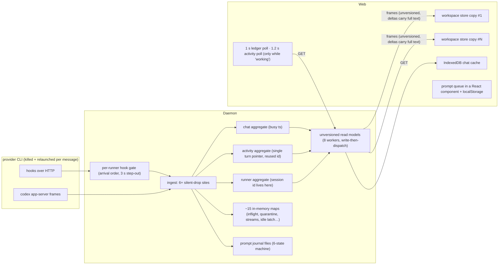
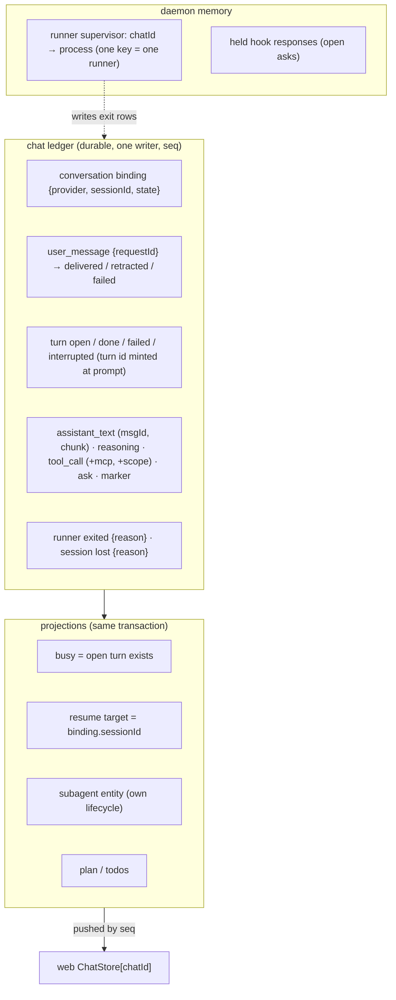
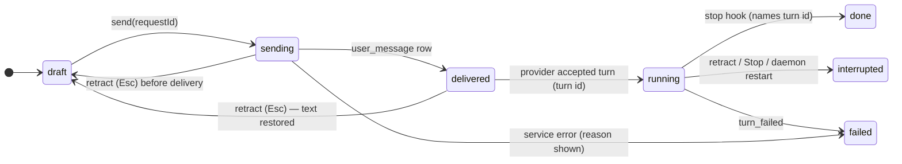

# The chat surface: where we go wrong, and the structure that fixes it

_2026-10-17. Synthesis of six audits run in parallel: Crowbar backend pipeline, Crowbar frontend
surface, bug archaeology (365 fix commits), T3 Code, Hermes desktop, and live hook captures from
`claude` 2.1.302 / `codex` 0.158.0. Every claim below has a `path:line` in the scratchpad audits
(`crowbar-backend.md`, `crowbar-frontend.md`, `bug-catalog.md`, `ref-t3code.md`,
`ref-hermes.md`, `design-surface.md`). The whole-codebase architecture this slots into is
`2026-10-16-crowbar-architecture.md`; rendering additions are in
`2026-10-16-chat-surface-additions-design.md`._

## TL;DR

- **The bugs aren't random. Five structural flaws in how the chat is built produce all of them**, and
  every one of your symptoms traces to at least one:
  1. **No single owner for a fact.**
     - "Busy" has 6 stored copies, read by 9 different deciders.
     - The provider session id lives in 5+ places, none of them the chat.
     - A chat exists in one client store per open workspace of its repo, plus IndexedDB.
  2. **A turn has no id.** One placeholder id is reused for every turn of a runner. Closing a turn
     closes whatever is open across the whole chat.
  3. **Truth is inferred from clocks and silence.** 30+ timers decide things like "is this session
     dead?", "did Escape happen?" and "is the turn over?".
  4. **Data is dropped silently.** Hooks get a 200 OK after being thrown away, and full buffers discard
     data. Only 4 kinds of tool are mapped, so everything else shows as a bare name.
  5. **The transcript is polled, not pushed.**
     - The client polls once a second.
     - Activity is polled only while the chat already looks "working".
     - Every streamed chunk carries the full text so far, and each open copy of the chat applies it.
- **The history proves patches don't converge.** 365 fix commits went into the chat in 5 months. They
  group into 123 root causes, and 72% of those only ever got patches. None of your nine symptoms has a
  structural fix that held. The spinner alone has been "fixed" 22 times. The fixes that *did* hold all
  had the same shape: one versioned owner, one reducer, and the id carried on the record.
- **A hidden multiplier: every message you send kills the agent CLI and relaunches it** with
  `--resume <id> -- <text>` (`prompt_submit: restart_tui` in both descriptors). So every message is a
  resume, which is where session ids get lost. Every message also pays a process spawn, which is part
  of why it feels slow. And Crowbar has to guess whether the new process picked up the prompt. That's
  **Decision 1** below.
- **The structure that makes these impossible** (fully in the architecture doc):
  - **One per-chat ledger.** It is append-only, numbered by the server, and written by a single
    writer. Busy, the current turn and the bound session are all computed from it.
  - **The chat owns its session.** It holds `{provider, sessionId}`, and only the CLI's explicit
    refusal can retire it.
  - **Turns get an id when they're created.** Every close names the turn it closes.
  - **Updates are pushed in order,** and a reconnecting client resumes from the last number it saw.
  - **One client store keyed by chat id.** Panes hold only ids.
  - **The outbox is a real state machine,** so Escape becomes `retract`.
  - **Nothing is dropped without a recorded row.**
- **What the references taught us:**
  - **T3 Code:** the decision logic, the events and the derived views are all saved in one database
    write. The stream is deduped by sequence number. At boot, chats still marked running with no live
    process are closed.
  - **Hermes:** the whole wire contract is declared once and generated for the client. Each session
    keeps a sequence number and a replay buffer.
  - **What we refuse from both:**
    - turns that only get an id once the provider names one;
    - "working" as a bag of booleans;
    - matching streamed text by comparing strings;
    - joining subagents to their tool call by guesswork;
    - timers as fences;
    - their 4–9k-line chat components.
- **Size:** the chat rewrite deletes about 4k lines of Go session-guessing and about 3k lines of web
  polling and queue code. The chat surface goes from 21k lines to 10k or fewer.

---

## 1. The five structural flaws

### 1.1 Today's shape

### 1.2 Each flaw and the bug class it allows

| # | Structural flaw | Bug class it allows | Evidence (headline) |
|---|---|---|---|
| G1 | The conversation (provider + session id) has no owner. It is re-derived on every message from per-turn tags, 30 s / 24 h windows, a file search through the provider's own folders, and an in-memory quarantine | Session silently replaced by a 20-turn text replay; a `/clear` guess moves the live CLI into a new chat | 12 loss paths; a code comment notes "47 of 49 codex turns untagged" |
| G2 | A turn has no id. It is spread over 3–4 stores, one placeholder id is reused, and closes are unscoped and sweep the whole chat | Busy forever, dark while answering, one turn's stop closing the next, tool rows bleeding across turns, asks no one can answer | `open-<chat>-<runner>` reused; `CloseStalledTurn` never releases the busy flag |
| G3 | Durable rows are rewritten from mutable memory buffers with whole-row upserts, and there's no per-runner sequence | A complete reply overwritten by its own tail fragment (reproduced from recorded Claude traffic) | `UpdateAll` keyed by provider message id |
| G4 | The event library neither orders nor versions. Same-aggregate commands run on 8 workers, data is written before dispatch, and projections overwrite each other | Read-your-writes races, read models going backwards. Every fix becomes "use `SendWait` here" | asynx v0.8.1 configuration |
| G5 | Copies plus read-time overlays: busy ×6, placement ×2, chat→cwd ×6 resolvers, provider ×3 sources, and the client holds N+2 copies of each chat | Rows jumping; routes 404 while the CLI runs; a pane frozen on a copy that receives no updates | the "known" gate on the client |
| G6 | Time used as evidence: 30+ timers (stall 120 s, quiet 30 s, idle 5 s, probe 30 s, step-out 3 s, 2 h staleness) | False abandons, 2-hour spinners, sessions declared dead | termwait, ladder, switchwait |
| G7 | Silent drops: rejected hooks get 200, the codex event pump drops on any error, and full buffers discard (startup barrier 64, mailbox 8192, WS 64) | "Lost forever, no trace" | 6+ drop sites in ingest |
| G8 | Pull, not push: transcript polled at 1 s, activity at 1.2 s and only while "working", and each delta carries the full text applied once per open store copy | Messages arriving late or never; O(L²) per streamed message; lag | `use-chat-messages.ts`, `use-agent-activity.ts` |

G4 and G5 are the soil the others grow in. The bug history counts the same thing from the other
end: 80% of the 123 root causes fall into classes that are "Crowbar keeps its own copy or guess of a
fact someone else owns", or into the process-model classes (leaks, unbounded waits, implicit state
machines, races).

---

## 2. Your symptoms, traced

| Symptom | Root cause today | Flaw | What makes it impossible |
|---|---|---|---|
| **Provider list empty** | **Daemon:** the PATH comes from a login-shell call at boot with a 5 s timeout and a silent fallback. An empty model catalogue gets saved to disk. **Client:** it hides providers with no models and keeps 1+N copies of the list | G5, G7 | One daemon-owned **ProviderAvailability** record per provider (descriptor ok/refused, binary found/not-found + where it searched, catalogue none/pending/ready/failed/empty, preference), pushed to the client. Every absence carries a reason. Embedded descriptors mean the list can never be empty |
| **Session id lost → conversation gone** | 12 paths, including turns tagged from a stale runner field, a DB error read as "no history", a 30 s quarantine, the 30 s / 24 h windows, a promote changing the cwd (admitted unfixed in `ebb634697`), a kill mid-turn, and a `/clear` guess | G1, G6 | The chat ledger owns `{provider, sessionId}`. For Claude it's pre-assigned with `--session-id`; for Codex it's taken from `thread.started`. Resume always passes that id. Only the CLI's explicit "no such session" moves the chat to a visible `lost` state |
| **Mid-turn messages lost** | Reply overwritten by its tail fragment; codex "first match" text; startup-barrier overflow; a displaced runner's final Stop dropped; 64-message eviction; abandons at 5 s / 30 s | G3, G6, G7 | Append-only rows keyed by (provider message id, chunk index). Streamed deltas are a side channel replaced by the final row. Nothing is ever rewritten by a later turn. A rejected hook gets an error status plus a dead-letter row |
| **Prompt sent, nothing renders / chat stops registering** | A stalled turn never releases busy, so every later send gets "busy". The transcript is only polled, and activity only while "working". The prompt queue's head waits on a `prompt_settled` it missed. A refresh asked for during the first load is dropped. The pane reads a store copy with no updates | G2, G5, G8 | The turn is a state machine with an id. "Busy" is computed from the ledger. The transcript is pushed in sequence order. The outbox follows server prompt states keyed by a client request id. There's no "known" gate: a pane with a chat id subscribes to that chat |
| **Escape after send does nothing** | Escape only acts when `working && live`, and "working" arrives later from the server. While the CLI is spawning the composer isn't even an input. The queue has no "cancel in-flight → back to draft" transition | G2, G5 | `retract(requestId)` is a service verb. Before delivery the row is retracted and the text goes back to the draft; after delivery it's a graceful interrupt. Escape maps to `retract(head)` without waiting on "working" |
| **History-sized blank space** | The transcript box is sized to the whole history but hidden until a settle loop finishes. That loop doesn't run when the chat isn't "known" or the first list request failed (the error is swallowed). The scroll layout is measured imperatively in a feedback loop (16+ patches) | G5, G8 | No visibility gate on the list. Stable row ids mean no remount when a reply settles. Anchoring to the bottom comes from CSS, not a JavaScript follow loop |
| **Slow / laggy** | **Per message:** a CLI kill and respawn. **Per delta:** the full text parsed, applied by each store copy, the transcript rebuilt and re-sorted with `Date.parse`, and the row remounted when it settles. **Per keystroke:** the whole draft re-serialized and the whole column re-rendered. Hidden xterm keeps parsing. HTTP hooks answer only after full ingest, and Claude waits on every tool hook | G8, G5 | Push append-only deltas. One store, with narrow per-chat and per-row subscriptions. A stable keyed row list. The composer keeps its own state and serializes only on send. Detach the terminal when it isn't shown. Answer hooks once the row is written, not after downstream work. Plus Decision 1 |
| **Subagents/tools/MCP without detail** | The descriptors map only 4 input keys. The canonical model has no title, MCP server or subagent fields. Subagent tool calls are dropped *on purpose*, and a test enforces it. MCP names are never split. There's no push | G7, G8 | Covered in the additions design doc. Both providers already send everything Claude Code's UI shows |

The non-chat symptoms (opening any file, editor speed, wrapped terminal links, silent branch import)
are traced in the architecture doc §7.

---

## 3. What the references teach

| | T3 Code | Hermes desktop | Crowbar target |
|---|---|---|---|
| Write model | Pure decider → events. Events, every SQL projection and an idempotency receipt commit in **one SQLite transaction**; subscribers hear about it only after commit | Server stamps a per-session `seq` at one write chokepoint | Per-chat ledger, one writer, `seq` assigned at commit, projections in the same transaction |
| Transport | Live stream attached *before* the snapshot, then a "synchronized" marker. Client drops duplicates by sequence. A slow client is forced to resync instead of its buffer growing | One WebSocket, JSON-RPC both ways; a replay ring plus a process epoch; live frames held during replay | One stream: snapshot + versioned deltas + ledger rows by seq + operation outcomes; epoch on the ready frame |
| Contract | Typed schemas | Declared once (Pydantic), generated to TypeScript, completeness tested | Declared once in `domain`, generated for the web, diffed in CI, unknown fields rejected |
| Boot | Any thread still "running" with no live process is forced to an error state | Fail-closed session lease + crash turn marker | Boot writes `interrupted` for every open turn without a live runner |
| What we refuse | A turn has no id until the provider names one; session status overwritten whole from 3 places; failures detected by matching output text; 4–9.5k-line components; react-markdown | Turn state as a bag of booleans; 4 client copies of the transcript; reconciling by text equality; subagent↔tool join by guessing from the goal string; TTL timers as fences | — |
| Provider channel | Codex app-server per thread; Claude Agent SDK | Its own agent | **Hooks + YAML descriptors, unchanged as the channel**. Descriptor-declared app-server where the provider publishes one |

Neither reference solves Crowbar's hardest problem: getting a provider's facts in through a channel
that can lose them. The answer to that is only ours: never acknowledge a hook before its row is
written, never drop one without a dead-letter row, and never let silence or a clock substitute for a
fact.

---

## 4. The target chat architecture

The full module map, lifecycles and journal rules are in the architecture doc (§3–§5). Here is the
chat slice of it.

### 4.1 Who owns what

### 4.2 Turn and outbox, as state machines

A late event for a closed turn is recorded as a late row. It never reopens the turn.

### 4.3 The hook ingress contract

1. A hook comes in. Resolve the runner, then the chat. If either is unknown, reply with a non-2xx and
   a reason, and write a dead-letter row the UI can count.
2. Map it through the descriptor into a canonical row. If mapping fails, write a dead-letter row
   holding the raw payload reference and the descriptor finding.
3. Append it to the chat ledger through the chat's single writer, which assigns `seq`.
4. Answer the HTTP hook only now. For a held ask, answer when it is settled.
5. Push the row to subscribers in `seq` order.

Steps 1–4 are synchronous and cheap: no git, no workspace reconcile, no forest walk. Anything
expensive is a downstream reaction to the row, so Claude's per-tool hook wait stays in single-digit
milliseconds.

### 4.4 The client

- **One `ChatStore` for the whole window, keyed by chat id.** It holds the chat's metadata, ledger
  rows, the live streaming message, the outbox and the draft. Workspace stores hold no chat state.
- **One subscription per scope.** Frames are applied by one reducer. On reconnect the client sends
  `since = lastSeq` for each chat.
- **The message id is the React key. Order comes from the server only.** The live message is one
  row updated in place; when it settles, the same row changes state and is not remounted.
- **Each row subscribes to its own slice,** so a delta re-renders the streaming row and nothing else.
- **The composer owns its own Plate state.** Markdown is serialized once, on send.

---

## 5. Decisions only you can make

1. **How prompts are delivered.**
   - **Today:** every message kills the CLI and relaunches it with `--resume <id> -- <text>`.
   - **Option (a):** keep restarting per message, but make it safe. The chat owns the session id,
     resume is always by id, and delivery is acknowledged by the provider's own `user_prompt` hook.
     It's the smallest change, but the spawn cost and the resume risk stay on every message.
   - **Option (b):** deliver into a live process through each provider's *published* programmatic
     channel, declared in the descriptor: Codex `app-server` (already used for "api connection"
     chats) and Claude's `--input-format stream-json`. Hooks stay the event source.
     - Faster, and there's no resume per message.
     - But a live Claude would then be headless, so the terminal view of a chat would need a
       different arrangement.
   - **Recommendation:** run a short spike that measures the cost of (a), the latency and loss rate
     of a restart per message, against (b) on both CLIs. Decide from the numbers. Until then, design
     the ledger so both work: delivery is a row either way.
2. **When a provider goes silent:** Claude emits no hook on ESC, for example. I recommend that the
   descriptor declares it as `not_emitted`. Crowbar then records its own interrupt row when *it* sent
   the interrupt, and otherwise shows "unknown". It never guesses on a 30 s timer.
3. **The thread read scope:** today any visible chat except a chat's own descendants is readable
   through `get_chat_log`. That includes siblings, which breaks the "context runs down" rule. Should
   reads be restricted to ancestors only? I recommend yes.

---

## 6. Order of work (chat slice of the architecture doc's S1–S2)

Each step starts with failing behaviour tests that reproduce the symptoms. They drive the daemon
over HTTP and WS, with a fake provider CLI scripted by a test descriptor (`tests/kit` already exists).
They also use the recorded Claude traffic in `usecases/chat/testdata`, which already reproduces the
tail-overwrite bug.

1. **Ledger + conversation (daemon):**
   - a per-chat writer and `seq`;
   - binding rows, with the session pre-assigned;
   - turn ids;
   - append-only text chunks;
   - dead-letter rows;
   - boot reconciliation as a projection pass.

   Delete the session-inference ladder, quarantine, file searches, age windows, the runner aggregate,
   the prompt journal files and termwait's stall/quiet half. Symptoms 2, 3 and 4 are closed by tests.
2. **Push + ChatStore (client):**
   - the ledger feed by seq;
   - the window-level ChatStore;
   - the outbox state machine with `retract`;
   - stable keys;
   - narrow subscriptions;
   - CSS bottom anchoring.

   Delete the polls, the streaming copy, queue persistence, the chat slice in workspace stores, and
   the remount on settle. Symptoms 4–7 closed; zero polling loops.
3. **Rich rows:** the descriptor mappings and canonical rows from the additions design doc, so tool,
   MCP and subagent rows show real detail. This closes symptom 8.
4. **Provider availability record** (symptom 1). Small and independent; it can go first if you want
   a quick win.

Each step leaves the app working and smaller. A step that adds a timer, a poll or a second copy to
get green is rejected (CLAUDE.md "Fixing bugs").
