# Crowbar architecture — the same product, half the code

_2026-10-16. Evidence (every count, every path:line) lives in the review scratchpad; this document cites headline numbers only. The chat-surface audits (backend, frontend, rendering) are folded in at module-boundary level._

## TL;DR

Crowbar is 238k lines of source carrying 355k lines of tests, and 39% of its commits are fixes — on the chat surface alone, 365 fix commits in five months, clustering into 123 root causes of which 72% were patched rather than removed. The bugs are not random: every one traced in the audits comes from a fact that has more than one owner (a chat in N store copies, a session id on the runner instead of the chat, sidebar placement in four aggregates, file text in Monaco _and_ a global store), from a lifecycle that is inferred from clocks or absence instead of being written down (which session to resume, whether an import failed, whether a turn closed), or from an outcome that has no channel back to the user (every 202). The code around those gaps is the bulk of the codebase: reconcile, settle, retry, poll, repair, landing-watchers, five dependency containers, 108 interfaces with one implementation each.

The target keeps every feature and removes the gaps structurally:

1. **One journal.** A chat _is_ its append-only ledger (server-assigned `seq`, single writer). Session binding, turns, tool calls, subagents, prompts, config changes, exits — all rows. Nothing about a chat is inferred.
2. **One stream.** A single multiplexed WebSocket carries versioned entity frames, ledger rows and operation outcomes. The client never polls and never keeps a second cache of server truth.
3. **Operations are entities.** Any work that outlives a request has an id and a terminal state the user sees. Silent failure becomes unrepresentable.
4. **Derived, not copied.** Sidebar rows, pane contents and transcripts are selectors over one normalized client store; panes hold ids only.
5. **Thin layers with enforced direction**, in both languages, with one wiring file and tests that drive the public HTTP/WS surface instead of 30 hand-written mocks.

Numeric target: Go source 127k → ≤ 60k, Go tests 242k → ≤ 70k, web source 106k → ≤ 55k, web tests 114k → ≤ 50k, every baseline (195 knip entries, 61 eslint, 46 deadcode) → 0, files over 500 lines (65) → 0, client polling loops (7) → 0, discarded Go errors (155) → 0. Ten stages (S0–S9); every stage ships a working app that is smaller than the one before.

---

## 1. What is wrong, structurally

The symptoms the user reported map onto four structural properties. Each property permits a whole class of bugs; the target removes the property, not the bugs.

| Structural property today | Bug class it permits | Where it is measured |
|---|---|---|
| A fact has several owners | Copies disagree; a late or swapped-in copy misses events; "known" means "present in some copy" | chat in every workspace store + IndexedDB; session id on the runner; placement in four aggregates; editor text in model and store |
| A lifecycle is inferred, not recorded | Wrong resume target; a live session treated as `/clear`; a turn that never closes; a stall timer standing in for a missing owner | 30 s / 24 h resume heuristics; stall/idle detectors; `open-<chat>-<runner>` turn ids |
| An outcome has no channel | Background work fails and nothing arrives; spinners forever; errors only as log lines | 202 handlers with no entity to carry an error; 155 `_ =` in Go; 111 bare `catch` in TS; 33 "wait until the row lands" watchers |
| Layers are porous | Every change crosses five containers and a mock file; engines import the app; the app imports its own DTOs; `lib/` imports features; feature cycles | the wiring files are the most-edited files in the repo; ~90 feature→feature edges with cycles |

The bug archaeology of the chat surface puts numbers on the same four properties: of 123 root-cause clusters, duplicated state is 16%, ordering/race 13%, provider-surface mismatch 12%, implicit state machine 11%, lifecycle leak 8%, scope confusion 8%. Five generators are still live in the code: truth decided by silence and age timers; a hooks-only ledger that drops what it cannot place; a "working" flag with seven or more writers; imperatively measured scroll layout; prompt delivery by killing and respawning the CLI with state split over a journal, a runner and a client queue. The fixes that _held_ all had the same shape — one versioned owner plus one reducer, identity carried on the record, one channel per process — and that shape is the whole of this document.

Everything in section 3 onward is justified by one of two sentences: _it removes a bug class_, or _it removes code_.

---

## 2. Target module map

Crowbar stays what it is: one Go daemon that owns worktrees, PTYs, provider CLIs and a journal; a React client that renders projections of it; a Tauri shell that is only a window and a transport.

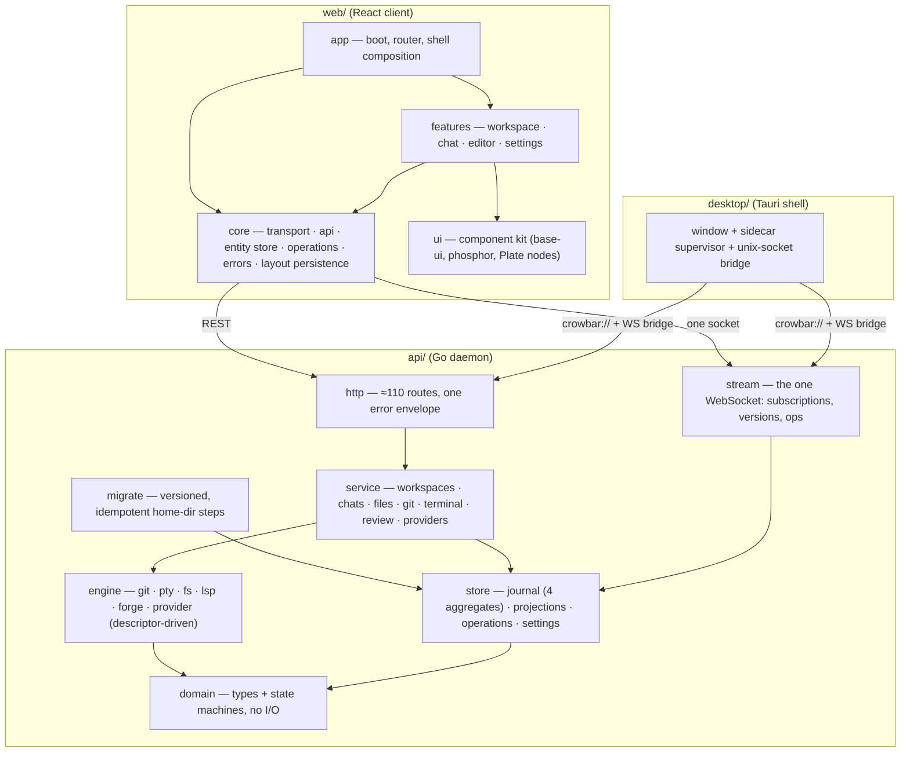

What disappears from today's map: the five container files and their setter injection (one `wire` file instead), the `dto` package (domain types are the wire types), the `hub` + `realtime` + `v0/ws` + `snapshots` chain (one `stream` package), the `usecases/mocks` package and the interface-per-usecase that exists for it, the runner aggregate inside an engine, the `agentjournal` adapter, the separate `agent_activity` / `agent_runner` / `agent_chat_conversations` stores, and on the client: `app-sync-engine`, the IndexedDB entity cache, the nine sidebar stores, the per-workspace store registry with its seven slices, three of four API-client modules, the `extensions` registry with no extensions.

### Dependency direction (enforced by lint in both languages)

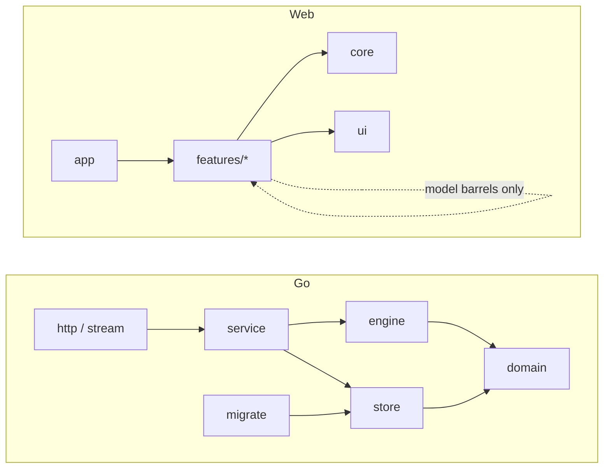

Rules, each a lint gate, each removing a bug class:

- **domain** imports nothing internal and does no I/O; it holds the state machines of section 5. A transition that is not in the diagram cannot be coded.
- **engine** packages are stateless adapters over the OS and the provider CLIs. They never persist, never broadcast, never import `store` or `service`. The provider engine reads the YAML descriptors and emits canonical rows; it is the only place provider vocabulary may appear, as today's hard law already says.
- **store** is the only writer of durable state. Four aggregates, each with a single writer per key, each projection versioned.
- **service** composes engines and the store into the verbs the API exposes. It has no interfaces of its own: a service is a struct with constructor-injected engines and the store. Tests drive services through HTTP.
- **http / stream** translate; they never reach past `service` into `store` or `engine`.
- On the client, **core** and **ui** are the floor; **features** may import each other's `model` barrel (state and actions) but never components; **app** is the only composer. No store lives under a component directory; `getState()` appears only in event handlers.

---

## 3. State ownership

Every fact has exactly one owner. Everything else is a projection that may be dropped and rebuilt.

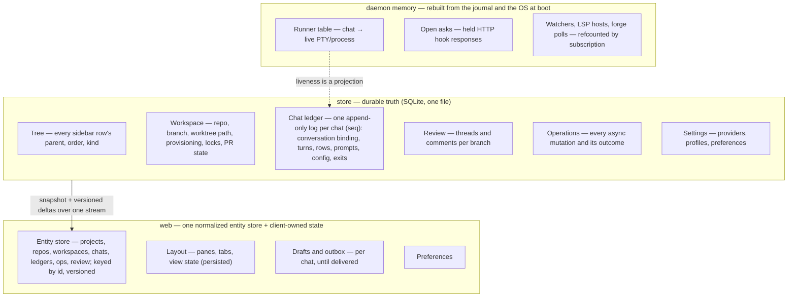

Decisions and what each removes:

- **The chat owns its conversation.** `{provider, sessionId, state}` is written in the same ledger row that records the provider's announcement; the chat's working directory is a projection of the workspace it is bound to, never a stored path. Resume is always by the stored session id, from whatever real path the bound workspace has — the spike verified both CLIs resume by explicit id from any directory. Resume targets are read, never inferred; an unknown announcement is surfaced as a row the user sees, never auto-moved to a new chat. Removes the session-inference ladder, the quarantine, the transcript fallback, the "move on unknown session" path and the only law violation in the daemon (globbing provider homes). Backend audit estimate: 3.5–4.5k Go source lines plus 1.5× that in tests.
- **The runner is a supervisor, not an aggregate.** Its durable facts (announcement, exit reason, "interrupted: daemon restart" at boot) are ledger rows; its liveness is a map. "One runner per chat" becomes a map-key invariant instead of read-after-write plus eviction. Removes the runner event store, its OCC retry, heal and placement projections.
- **Sidebar placement has one owner, the Tree.** Chats and workspaces carry no `parentId`/`order`; folders are Tree rows. A create is one Tree write plus one entity write, published together with one operation. Removes placement commands from two other aggregates, the folders table, the frontend's two-aggregate landing watchers and ghost-row suppression.
- **Prompts are ledger rows.** A prompt is written (durably, before the CLI is touched) as a `user_message` row with the client's nonce, then advanced by rows: delivered, settled, retracted. Removes the fsync'd prompt journal and its six-state machine, and the client's localStorage queue.
- **Operations are rows.** Every 202 returns an operation id; the operation's terminal state is pushed. `lastError` on an entity is a projection of its latest failed operation. Removes both lossy error channels and the "spin forever" class.
- **The client keeps no second copy of server truth.** The entity store is filled from the stream's snapshot on subscribe and advanced by versioned deltas; on reconnect it resumes from its last version and last `seq` per chat. The IndexedDB entity cache, its version-wipe heuristics and its reseed GETs go. Boot renders from the daemon snapshot; the daemon is local, so this costs a splash, not a round trip.
- **Panes hold ids.** A pane references `chatId` or a document id; `workspaceId` is read live from the entity. Removes the copied `pane.workspaceId` and the ambient-fallback class the memory notes call out.
- **A chat's workspace is one field, answered by one resolver.** A chat either owns a workspace or inherits its nearest ancestor's; that answer is a projection on the chat entity, used by every route and every pane. The backend audit counts six resolvers in two families today, which is how a chat can run while every route for it answers 404. When a Tree move changes that answer for a chat, the move and the chat's rebind (§9) are one operation.
- **Provider availability is an entity, not an empty list.** Each provider carries a state and a reason — binary not on the login-shell PATH, catalogue fetch failed, no models — pushed like any other entity. The settings screen and the picker render the reason; an empty provider list is unrepresentable because absence is never the signal.
- **Monaco owns buffer text.** The buffer store holds identity, dirty flag and view state; text is read from the model on save, close and persist. Highlighting and LSP attach to the model. Removes the content sink, the external-apply latch, the store→model reconcile, and makes a keystroke O(edit) instead of a whole-window state transition plus an IndexedDB write.

### Journal invariants

The store is the only place these hold, and they are what make "it happened but nothing shows" and "it shows but never happened" unrepresentable:

- **One transaction.** A command is decided serially against the aggregate's current state; its events, the projections they update and the command receipt commit together; subscribers hear about it only after commit. Today's kernel dispatches after writing with eight workers per shard, so a projection can apply event _n+1_ before _n_. asynx stays and gains these as library guarantees: one worker per aggregate, per-handler delivery in version order, projections and the command receipt inside the append's transaction, and a fenced forget. The chat ledger is an append-only table of its own, not an asynx aggregate, so an append costs the same at row 10 000 as at row 1.
- **Client-minted command ids with sticky receipts.** Every mutation carries an id the client minted; a retried send cannot create two prompts, and a rejection stays rejected. The prompt's nonce is one instance of this rule.
- **Ids are minted at command time.** A turn has an id before the provider names one; provider ids map onto Crowbar ids, never the reverse. Removes the `open-<chat>-<runner>` sentinel and every heuristic that waits for a provider to say which turn it meant.
- **Specific events, never whole-object writes.** `turn started`, `turn ended with reason`, `session bound`, `runner exited` — each validated against the diagrams in section 5. A state is never the result of "whatever the last writer computed from its own earlier read".
- **Side effects run from a durable cursor.** A prompt row that has no delivered row after a crash is re-driven or marked interrupted at boot; a running turn with no live runner is closed as interrupted. Boot reconciliation is a projection pass, not a special case.
- **Server-canonical time and order.** Timestamps are stamped on write; order is `seq`. Client clocks never sort anything.
- **Append-only means never rewritten.** A row written by turn _n_ cannot be touched by turn _n+1_; a correction is a new row that references the old one. Streamed text is kept as chunks keyed by message id and index until the provider's own final text supersedes them. There are no chat-wide sweeps on close: every close names its turn. The backend audit reproduced "messages lost mid-turn" from recorded traffic precisely because today's close rewrites earlier rows and sweeps the chat.
- **Ingress never discards.** The ordered per-chat log is the queue; when it is behind, the hook reply waits (back-pressure) instead of a mailbox overflowing or an event being logged and dropped with a 200. A dropped fact must be unrepresentable, not merely logged.

---

## 4. Data and event flow

### The one stream

```mermaid
sequenceDiagram
  participant UI as web entity store
  participant S as stream
  participant J as store (journal)
  participant Svc as service
  participant E as engine (provider / git / pty)
  UI->>S: subscribe scope (project:*, repo:r, chat:c, ws:w/git, …)
  S-->>UI: snapshot (entities with versions; ledger from seq N)
  UI->>Svc: REST mutation
  Svc->>J: write (single writer per key; version/seq assigned here)
  J-->>S: committed delta
  S-->>UI: entity frame (kind, id, version) · ledger frame (chat, seq, row) · op frame (id, state)
  E-->>Svc: hook / git / pty event
  Svc->>J: write
  J-->>S: committed delta
  S-->>UI: frame
```

Properties: frames are ordered per key, idempotent (version or seq), and resumable. The client attaches live _before_ it reads the snapshot and dedupes by `seq`, so nothing published during the initial load is lost or applied twice. The ready frame carries a daemon epoch, so a client resuming after a daemon restart cannot believe its old watermark. A slow client gets a bounded buffer that fails loudly into "resume from `seq`", never a silently truncated stream. Streamed text deltas ride the same socket as an ephemeral side-channel keyed by `(chat, messageId)` and are superseded by the final row; `seq` advances only on rows, so write amplification stays off the hot path. Server-to-client asks (permissions, questions) live in a registry settled under one lock: answering is idempotent, and an unanswered ask is re-delivered with the reconnect snapshot, so a prompt can neither be answered twice nor lost on a reconnect. Today's eight stream definitions, thirty-three hub methods, snapshot module and the client's three periodic and four edge-triggered polls collapse into this one path.

The wire contract is declared once, in `domain`, and the client's types are generated from it and diffed in CI; unknown fields are rejected on both sides. This retires the separate `dto` package and the hand-kept client type file, and makes field drift between daemon and client a build failure instead of a runtime mystery.

### A prompt, end to end

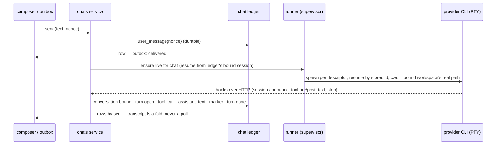

Escape after send is a service verb, `retract(nonce)`: if the row is not yet delivered it is marked retracted and the text returns to the draft; if the turn is running it is a graceful interrupt. Both are rows, so the outcome is visible and testable. Because the Claude CLI emits no hook on its own Escape, Crowbar authors the interrupted state itself; it never waits for a provider to confirm a stop.

Hook ingress stays off the agent's critical path: the provider blocks on every pre/post-tool hook reply, so the reply waits only for the append to the ledger; projection and publication follow on the chat's single writer. Only asks and steers hold the reply open, because their answer _is_ the reply. The rendering audit found today's ingest projecting synchronously before answering, and dropping Claude subagent tool calls while routing Codex's through a second path — one `scope` field on every row replaces both.

### Canonical ledger vocabulary (from the rendering audit)

Seven row kinds — `user_message`, `assistant_text`, `reasoning`, `tool_call` (with MCP server/tool and a spawned scope when it launches a subagent), `ask`, `marker`, `turn_failed` — and three projected entities — `turn`, `subagent` (its own lifecycle, since a spawning call completes before the child finishes), `plan` (fed by replace and upsert operations). Every row carries `turn`, `scope` (empty for the main agent) and `seq`. Both providers map onto this in YAML; Go contains none of their words. This is also what fixes "tool calls render as _Tool call_": the detail the UI lacks is already in the hooks and now has a row to live in.

---

## 5. Lifecycles

These are the state machines in `domain`. Nothing outside `domain` decides a transition; nothing is inferred from time or absence. "Is the agent working?" is not a flag anyone writes: it is the turn projection, which is a fold of the ledger, which has one writer. A spinner therefore cannot outlive its turn, and a turn cannot outlive its runner.

```mermaid
stateDiagram-v2
  direction LR
  [*] --> unbound
  unbound --> bound : provider announces session (row)
  bound --> lost : resume refused / session never materialised (row, reason)
  lost --> bound : user rebinds or starts fresh (row)
  bound --> bound : workspace rebound (row) — same session id, new real path
  note right of bound : Conversation — owned by the chat ledger. Resume by stored id only; never by "last" or "continue".
```

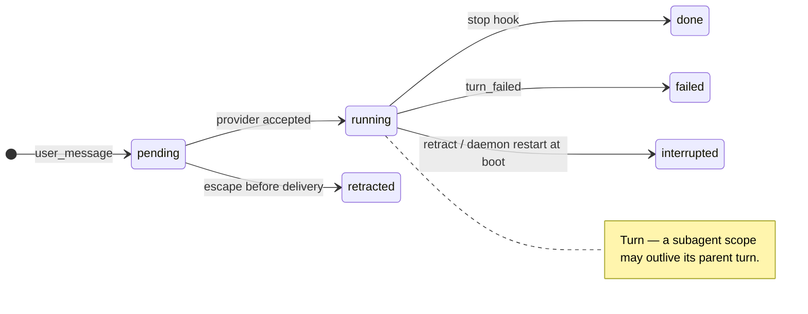

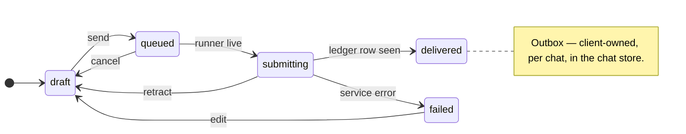

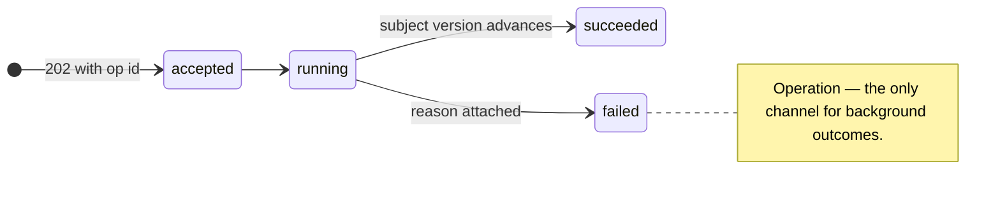

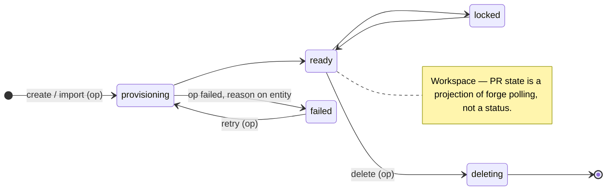

```mermaid
stateDiagram-v2
  direction LR
  [*] --> starting : ensure live
  starting --> live : first hook (session announced)
  starting --> prompting : launch prompt recognised on screen (ask row)
  prompting --> live : answered
  live --> exiting : stop / displace
  exiting --> exited : exit row written
  starting --> exited : spawn failed (row)
  note right of live : Runner — memory only; starting is left by a hook or a recognised prompt, never by a timer. Boot writes "interrupted" for every chat with an open turn.
```

---

## 6. Error-surfacing discipline

- A Go error is returned to the caller, attached to an operation, or a bug. No discarded errors, no log-and-return-nil in `service` or `store`; `slog` is for engines with no caller (watchers) and even those publish a health fact.
- One HTTP error envelope with a closed code enum in `domain`; the mapping table lives next to the enum, not spread over eight packages.
- Operations carry failures; entities carry `lastError` only as a projection of their latest failed operation.
- The client has one `report(error, context)` in `core/errors` that routes to a toast, an inline row badge or an operation chip. Empty `catch`, `.catch(() => {})`, floating promises and `bestEffort` are lint errors.
- Every lifecycle above has a `failed`/`lost` state with a reason. "Lost session" is shown, with a rebind action, never silently degraded to a capped transcript.

---

## 7. Case studies — the structural fix for each non-chat symptom

| Symptom | Root cause (today) | Structural fix (target) |
|---|---|---|
| Can't open files outside the workspace | A document is addressed as `(workspace, relative path)`; the containment guard is also the only authorization model; the native dialog hook is a stub | A document is an absolute host path plus an authority: `workspace` (always) or `host` (only on the local desktop transport, only for paths handed over by dialog, drop or terminal link). Authorization is a property of transport and grant; one file API |
| Editor slow to open / interact | One Monaco environment per _workspace_ store; full file text copied into the global immer layout store 150 ms after each keystroke, 56 subscribers, IndexedDB save 300 ms later; full-bundle grammar load on first open | One Monaco environment per window; model-owned text; layout store holds no content; grammars loaded per language from a slim bundle |
| Wrapped terminal links cut in half | The screen model serializes every row hard-broken (no wrap bit from the pinned emulator); two link detectors each reason about one physical row | The model owns a per-row `wrapped` attribute, serializes wrapped rows unbroken; one link tokenizer over the logical line; conformance case for wrapped links |
| Branch import/create fails with no reason | 202 + detached work; the only error channel is `lastError` on an entity that may not exist yet; the client infers outcome by watching rows land | Operations (section 5); the row shows its operation; no landing watchers |

---

## 8. Hard decisions

**Delete outright**
- The five DI containers and setter injection; the `dto` package; `hub`, `realtime` lifecycles, `v0/ws`, `snapshots`; the runner event store; `agentjournal`; the session store that globs provider homes; `descriptorcheck` moves from `engine` to a test.
- `usecases/mocks` and the 108 one-implementation interfaces that exist for it.
- On the client: `app-sync-engine`, the IndexedDB entity cache and its repair/wipe code, nine `lib/store` sidebar stores, `pending-creates` and every landing watcher, the per-workspace store registry and its seven slices, `prompt-queue-persistence`, the `extensions` registry and six of seven icon themes, the twelve unused kit components, dead chat-tree helpers, `best-effort`.

**Merge**
- Four API-client modules and ten raw `fetch` call sites into `core/api`.
- Thirty-seven sidebar files into one `features/workspace/tree` with one row-derivation function.
- Two terminal link providers into one.
- Three file-read paths into one document service.
- Six event-sourced aggregates plus nine CRUD tables into four aggregates plus one settings table, in one SQLite file.

**Rewrite**
- The chat pipeline around the ledger (both sides) — the audits' module-boundary design above.
- The sidebar as a projection of Tree + entities.
- The editor host (per-window Monaco, model-owned content).
- Package layout: 219 Go packages at depth 9 → ≤ 60 at depth ≤ 5; a package per concept, not per visibility trick.

**Keep as is**
- The terminal screen model and its conformance suite (add the wrap bit).
- The git, fs, lsp and forge engines (trim, don't redesign).
- The YAML descriptors (v3) as the only home of provider knowledge.
- Views-as-tabs, panes, drag-to-split as client-owned layout.
- Plate for all markdown; Monaco for code; Excalidraw attachments.

**Testing**
- Behaviour tests drive the daemon through HTTP + WS against a temp home with a fake provider CLI driven by a test descriptor; `tests/kit` already exists for this. Domain state machines get table tests. The 30-mock unit suites (chat alone: 5.6 test lines per source line) are retired with the interfaces they mock.
- The client tests features through rendered components and the entity store, with the stream faked at `core/transport`; no `vi.mock` of sibling modules.

---

## 9. Home layout and the migration engine

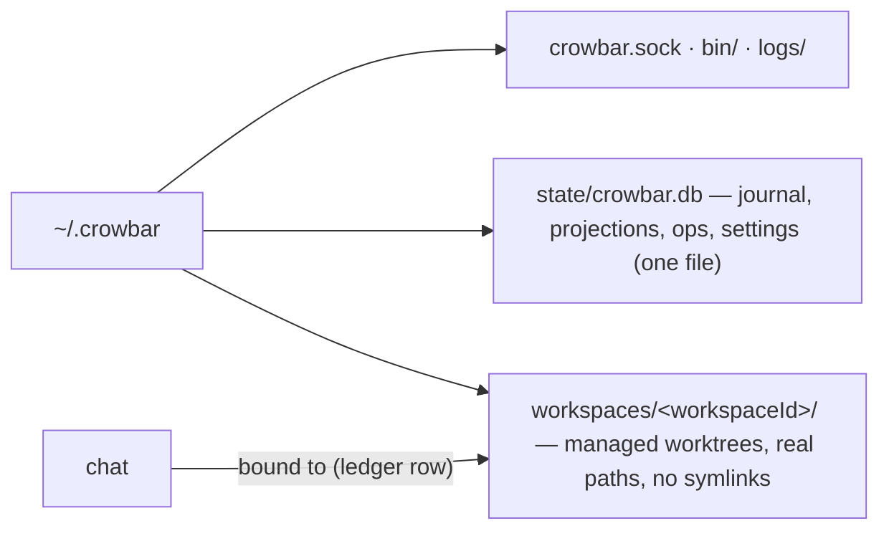

The spike settled the question this section used to hedge: **both CLIs resume by explicit session id from any directory** — the spike's Q1 and Q2 runs resumed the same Claude and Codex conversation from the new worktree's real path and from an unrelated non-git directory, with facts planted from one directory visible from the others. Both record the real path and never a symlink (so do git, the hooks and Crowbar's own spawn plan), Codex's sandbox refuses a symlinked working directory outright, and a live process cannot follow a swap. A path anchor is therefore unnecessary and harmful. The invariant is instead: **the chat owns the session id; its working directory is a projection of the workspace it is bound to.** Rebinding is a ledger row, and the next launch resumes the same conversation from the new real path; the providers themselves tell the model the directory changed.

Those runs used the CLIs' headless modes; a second round drove both interactive TUIs and closed that gap. Both resumed the same conversation in a new worktree with Crowbar's own resume flags while a sibling thread kept running, undisturbed, in the parent folder. Codex showed no prompt, because the descriptor pre-answers trust and the resume directory; Claude shows its workspace-trust dialog only on the first launch in a repository it has never trusted, which Crowbar already recognises. The rule stays: **a launch prompt is either pre-answered in the descriptor's resume plan or recognised on the screen model and surfaced as an ask row**; a runner never sits silently behind a modal with an empty pane. One case is still untested: resuming in the TUI into or out of a project home, which is not a git repository.

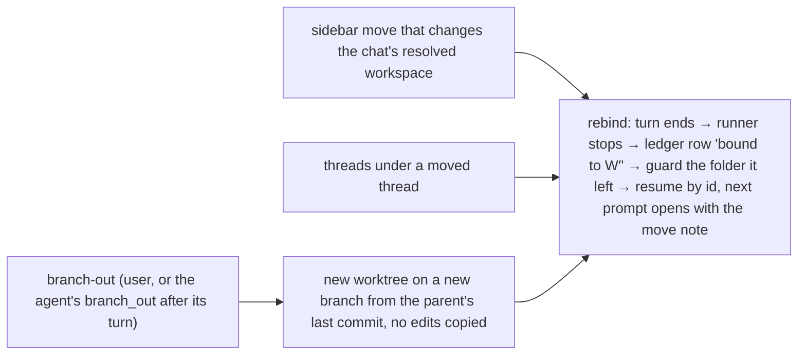

**Moving a chat is one operation, the rebind, and turning a thread into a branch is one use of it.** Every way a chat changes folder goes through it: a Tree move that changes the chat's resolved workspace (the move and the rebind commit as one operation, because a live process cannot follow a move), the descendants of a moved thread (each at the end of its own turn), and branch-out, which first creates a worktree on a new branch from the parent worktree's local last commit and then rebinds. No uncommitted edits are copied, and the parent is untouched. So a thread started in a project home can be moved under a branch and later branched out, keeping one conversation throughout; moves across projects work mechanically and are a product decision. Today's promote verb is the seed, but it branches from the remote parent (dropping unpushed commits) and can fall back to a text replay; both behaviours go.

A moved conversation still holds absolute paths into the folder it left, and the TUI round showed both CLIs using them: asked to extend "the file you edited earlier", both aimed at the old folder, and Codex wrote into a sibling's worktree. The CLIs' own protection depends on the permission level, and both approval prompts default to yes. So every rebind does two things. The first prompt after it opens with a one-line move note — the new branch and folder, the starting commit, and that edits left in the old folder were not brought over and are not to be re-applied unless asked — after which both CLIs wrote only in the new folder. And a pre-tool hook refuses writes, shell commands included, into any folder the chat has left, naming the new one; matching paths inside shell commands is best effort, so the sandbox's writable roots are the bound workspace wherever the permission level keeps a sandbox. The note prevents the mistake; the guard refuses it in every permission mode.

Resume hazards become rows, never heuristics: a session is resumed only by its stored id (the "continue last" forms of both CLIs silently start a new conversation when nothing matches); a Claude process killed before its first model request leaves nothing to resume, so the conversation is `lost` with that reason and a fresh start is offered; a Codex process killed right after a turn starts resumes but drops that first prompt, so a prompt is `delivered` only when the provider's own acknowledgement has been recorded — until then it is re-driven at the next launch.

The migration engine is a permanent, small module: an ordered list of idempotent, versioned steps over the home directory and the database, applied at boot before the daemon serves, recorded in `migrate/ledger.jsonl` (migration engine plan R1), reported on the health endpoint. First steps: fold today's twelve event/snapshot/store databases into one; move worktrees under `workspaces/`; record each existing chat's session id and bound workspace as ledger rows; stamp a protocol version so stale client caches are dropped once.

---

## 10. What the reference architectures confirm — and what we refuse

Two MIT-licensed references were audited for contrast. Both arrived, by different routes, at the properties above: one commits decider output, projections and the command receipt in a single SQLite transaction and dedupes a live stream by sequence with boot reconciliation of orphaned running state; the other stamps a per-session sequence at one write chokepoint, replays from a watermark with a process epoch, and declares its whole wire contract once and generates it. Those are the parts this design adopts.

Both also show what this design must not do, because each of these is already a bug generator in Crowbar: several hand-maintained projections of the same events kept consistent by comments; a turn with no identity until the provider names it, patched with a two-minute window; "working" as a bag of booleans; streaming reconciliation by text equality; subagent-to-tool joins by heuristic; and timers as fences — owner holds, activation leases, settle delays, linger auto-dismiss, polling of background processes. Where a reference reads provider transcripts, Crowbar does not: the hooks carry every fact the ledger needs, and the descriptors remain the only place a provider's vocabulary is spoken.

## 11. Staged migration

Every stage leaves the app working, deletes more than it adds, and ratchets a gate. The order follows user pain: the chat first, then the foundations the rest of the shrink depends on, then the thinning.

```mermaid
flowchart LR
  S0["S0 Ratchet gates"] --> S1["S1 Ledger + Conversation (daemon)"] --> S2["S2 ChatStore + push (client)"] --> S3["S3 Operations + error discipline"] --> S4["S4 One stream, one entity store, Tree"] --> S5["S5 Editor host + documents"] --> S6["S6 Terminal wrap bit"] --> S7["S7 Thin the daemon"] --> S8["S8 Home layout + migrations"] --> S9["S9 Client module law + kit trim"]
```

| Stage | Delivers | Deletes | Gate that ratchets |
|---|---|---|---|
| S0 | Per-module LOC budgets, timer/`_ =`/empty-catch counters, 500-line cap for new files | — | Baselines may only shrink; budgets fail CI on growth |
| S1 | Per-chat ledger with `seq`; chat-owned conversation; runner as supervisor; hook ingress writes rows; chat feed pushes rows | Session inference, quarantine, transcript fallback, `agentjournal`, runner aggregate, activity/runner/conversation split, stall-as-owner | Symptoms 2, 3, 4 closed by HTTP/WS behaviour tests; chat subtree −10k src, −20k tests |
| S2 | Window-level ChatStore fed by push; outbox state machine; `retract`; stable row ids and one order key; canonical row rendering | Ledger/activity/busy polls, streaming copy, prompt persistence, chat slice in workspace stores, remount-on-settle | Symptoms 4–8 closed; zero polling loops; `features/agent` ≤ 12k |
| S3 | Operations in store and stream; one error envelope; `report()` on the client | Both lossy error channels, `pending-creates`, landing watchers, `reparent-settle`, `bestEffort` | Import/create failure visible in tests; `_ =` → 0; empty catch → 0 |
| S4 | One stream with versions; one entity store; Tree aggregate; sidebar as a selector | `app-sync-engine`, IndexedDB entity cache, nine sidebar stores, placement in chat/workspace, folders table, hub/realtime/ws/snapshots | Sidebar ≤ 5k; stream defs 8 → 1; aggregates 6 → 4 |
| S5 | Monaco per window; model-owned text; host documents on the local transport; slim grammar bundle | Content sink, apply latch, store→model reconcile, per-workspace editor managers, open benchmark | Open-file and keystroke budgets measured in Tauri; symptoms in §7 rows 1–2 closed |
| S6 | Wrap bit in the screen model; one link tokenizer | Second link provider, "accepted residual" | Conformance case for wrapped links |
| S7 | One `wire` file; services without interfaces; packages flattened; routes 237 → ≈110; behaviour suite as the gate | Containers, `dto`, `mocks`, setter injection, mock-based suites | Go src ≤ 60k, tests ≤ 70k, packages ≤ 60, depth ≤ 5 |
| S8 | `migrate` module; one database; `workspaces/` with real paths; rebind as the only way a chat changes folder (turn boundary → ledger row → move note + write guard → resume by id); `branch_out` = worktree from the parent's last commit + rebind | Twelve database files; path-derivation special cases; promote-from-remote and text-replay fallback | A thread moved from a project home under a branch, then branched out, keeps one conversation in both providers' TUIs and writes nothing into a folder it left |
| S9 | Lint-enforced layer rules on the client; one API client; kit trimmed | `extensions`, unused kit files, dead features, three API modules | knip / eslint / deadcode baselines = 0; web src ≤ 55k |

### What "done" looks like

| Metric | Today | Target |
|---|---:|---:|
| Go source / test LOC | 127k / 242k | ≤ 60k / ≤ 70k |
| Web source / test LOC | 106k / 114k | ≤ 55k / ≤ 50k |
| Go packages / depth | 219 / 9 | ≤ 60 / 5 |
| Wiring LOC / exported usecase interfaces / mocks | 4.4k / 108 / 30 | ≤ 400 / ≈ 8 ports / 0 |
| Routes / stream defs / hub methods | 237 / 8 / 33 | ≈ 110 / 1 / ≈ 6 frame kinds |
| Aggregates + tables | 6 + 9 | 4 + 1 |
| Client stores / IndexedDB stores / localStorage keys | 28 + 7×N / ≥ 10 / 12 | ≤ 8 / 2 / prefs only |
| Sidebar / chat-surface LOC | 18.1k / 21.1k | ≤ 5k / ≤ 10k |
| Files > 500 lines | 65 | 0 |
| Baselines (knip / eslint / deadcode) | 195 / 61 / 46 | 0 / 0 / 0 |
| Polling loops per chat / timers in client source | 7 / 87 | 0 / ≤ 15 (animation) |
| Discarded Go errors / bare TS catches | 155 / 111 | 0 / 0 |

The number that matters most is not in the table: a bug class that the structure forbids never gets a `fix:` commit.
