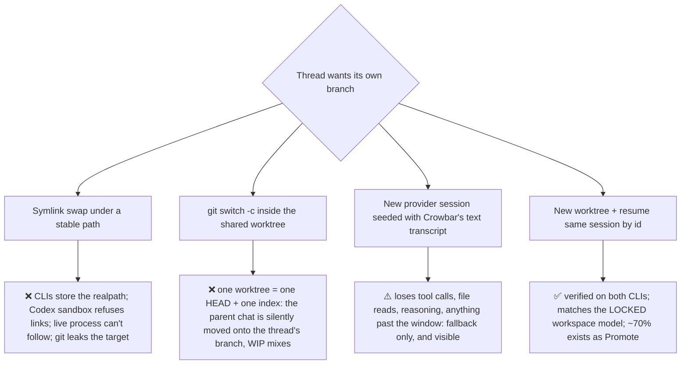
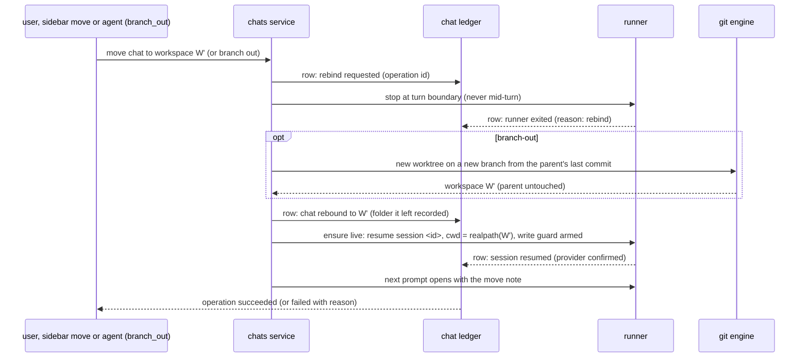
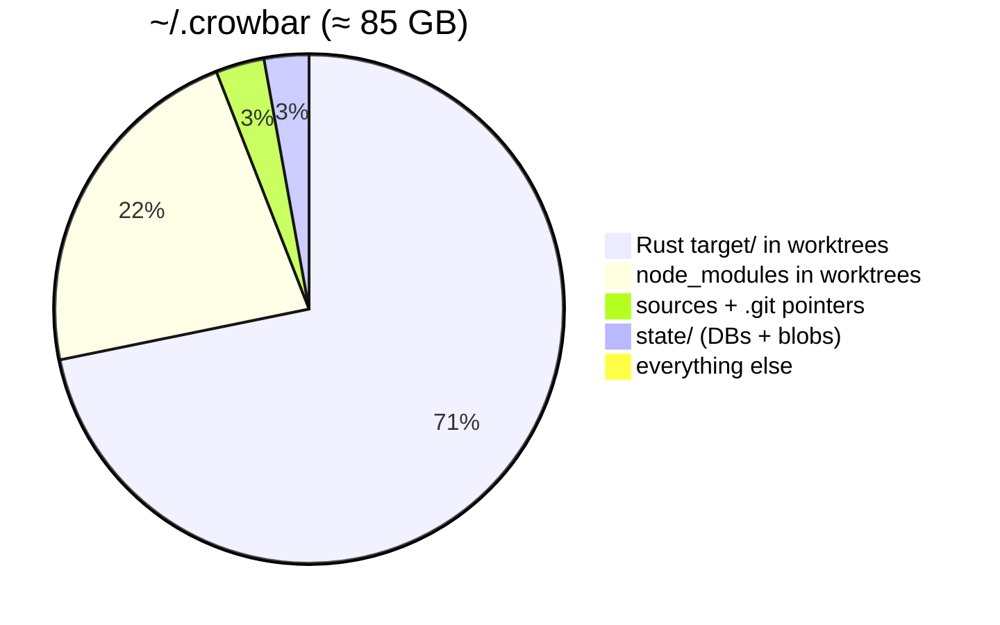
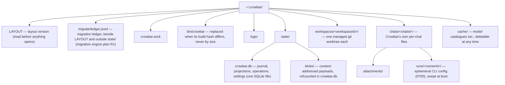
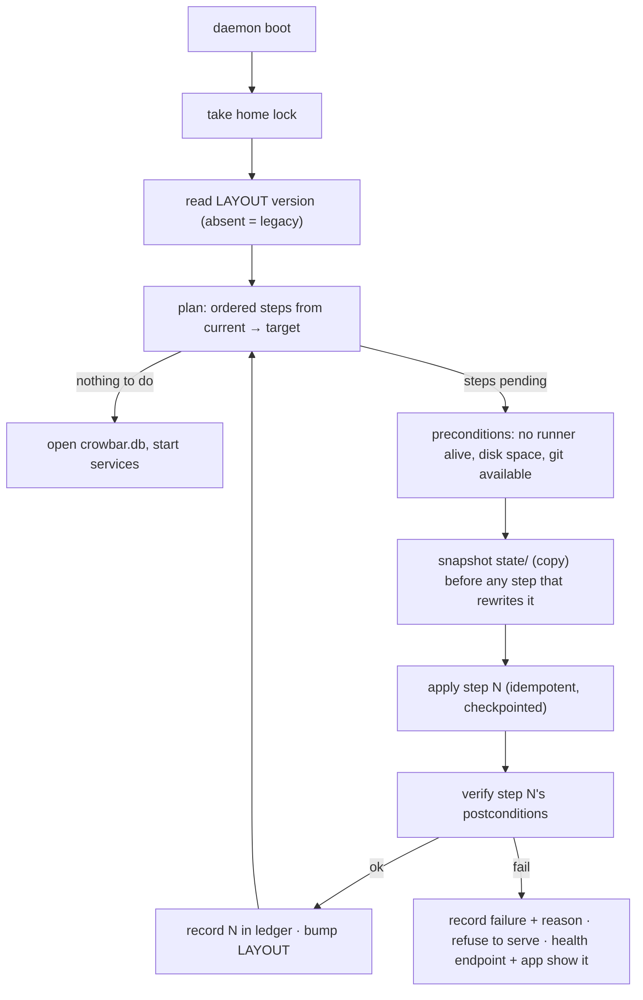

# Threads → branches, the Crowbar home, and the migration engine

_Spike + audit, 2026-10-16/17. Evidence (CLI transcripts, path:line, DB-copy queries) lives in the
session scratchpad (`spike-thread-branch.md`, `home-audit.md`). Companion to
`2026-10-16-crowbar-architecture.md` (§9) and `2026-10-16-chat-surface-report.md`._

## TL;DR

- **The symlink idea is not needed, and it would break.** Both `claude` and `codex` resume a
  session **by explicit id from any directory**, headless and in their interactive TUIs. I re-ran
  this myself: started in one folder, resumed from another, and the codeword came back. Both CLIs
  also tell the model on their own that its working directory changed. Symlinks fail for three
  reasons:
  - Both CLIs, git, hooks and Crowbar itself store the *real* path, so a link is invisible to them.
  - Codex's sandbox refuses a symlinked working folder outright.
  - A running agent cannot follow a swap. It stays in the old folder, or ends up half in each.
- **Moving a chat is one operation, a rebind, and branch-out is one use of it.** A rebind waits
  for the turn to end, stops the CLI, points the chat at the new workspace, and resumes the
  **same** provider session by its id from the new folder. Every change of folder goes through it:
  - moving a thread in the sidebar to a place with a different workspace;
  - the threads under a moved thread;
  - branch-out: create a worktree on a new branch from the parent's last commit, then rebind.
    **No uncommitted edits are copied**, and the parent folder is untouched.

  So a thread started in a project home can move under a branch and later become its own branch,
  keeping one conversation throughout.
- **A moved thread aims at the folder it left.** In the TUI test, both CLIs tried to write into the
  old folder when asked to extend "the file from before", and Codex wrote into a sibling's folder.
  So every rebind adds a one-line move note to the next prompt (with it, both wrote in the right
  place) and arms a hook that refuses writes into the old folder.
- **The trigger:** the user clicks it, or the agent calls a `branch_out` tool that runs once its
  turn ends. Crowbar already has about 70% of this, called `Promote`. What's wrong with it today:
  - it forks from `origin/<parent>`, which drops commits not pushed yet;
  - only the user can trigger it;
  - it can quietly fall back to replaying the conversation as plain text.
- **The "stable per-conversation folder" you wanted is the chat id, not a path.** The chat owns
  `{provider, sessionId}`. Where it runs is just "its current workspace". That one change also
  removes the main cause of *"Crowbar lost the provider's session id"*. Today Crowbar drops a
  session id on guesses: a search through the providers' own files, a 30-second rule, a
  "no turns yet" rule. It should only drop one when the CLI itself refuses the id.
- **`~/.crowbar` today (83 GB):**
  - 80 GB is build output (Rust `target/` and `node_modules`) inside worktrees. 57 GB of that sits in
    worktrees whose PR already merged, or that Crowbar has no record of.
  - 185 of 187 project folders are empty.
  - One chat's data is spread over **ten places**, and "chats folder" means five different things.
  - 46% of stored tool payloads are orphaned.
  - Deleting a chat erases its main record *first*, so an interrupted delete leaves orphaned data that
    nothing can find again (it happened at 22:56 last night).
  - There is no layout version anywhere.
- **New home:** one database file, worktrees keyed by workspace id, one folder per chat for
  Crowbar's own files, caches set apart, and nothing else.
- **Migration engine:** one small permanent module that runs before the daemon opens anything. It
  applies numbered, repeatable steps, records each result in a log, offers a dry run, and refuses
  to start the app on a failed step instead of continuing half-migrated. Every future layout change
  ships as a step through it.
- **Decisions only you can make:** listed at the end (6 items).

---

## Part A — Threads become branches

### A1. What was tested

The setup was a scratch repo with two linked worktrees, A and B, plus a stable link L → A that we
swapped atomically. The runs used `claude` 2.1.302 on haiku and `codex` 0.158.0 on its smallest
model, about 35 runs costing under $0.10. Nothing under `~/.claude` or `~/.codex` was read; every
conclusion comes from what the CLIs did.

| Question | Claude | Codex |
|---|---|---|
| Resume by id from the swapped link | ✅ same session, writes land in B | ✅ same thread, writes land in B |
| Resume by id from B's real path | ✅ | ✅ |
| Resume by id from an unrelated non-git dir | ✅ | ✅ |
| Does the model hear that its cwd changed? | ✅ "Primary working directory now …" | ✅ new environment-context block |
| What path does it record when started from L? | the **realpath** (A) | the **realpath** (A) |
| Working folder given as a symlink with the write sandbox on | — | ❌ "symlinked writable roots are not supported" |
| `-c` / `resume --last` when nothing matches | ⚠️ exit 0, **silently a new session** | ⚠️ exit 0, **silently a new thread** |
| Resume with an unknown id | exit 1, clear message | exit 1, clear message |
| Agent killed before its first model request | ❌ not resumable | n/a |
| Agent killed right after a turn starts | n/a | ⚠️ resumes, but **the first prompt is gone** |
| Live process when L is swapped | stays entirely on A | stays on A |

On top of that, git resolves everything to real paths (toplevel, hooks, the worktree registry), and
so does Crowbar's own spawn code. In a symlinked folder, the first `git rev-parse` an agent runs
tells it the real location. A path it caches from then on goes stale at the next swap.

**Second round: the interactive TUIs.** Both TUIs were driven in tmux (15 model turns). A sibling
thread ran mid-turn in the parent folder throughout, and the new worktree was created from the
parent's last commit.

| Question | Claude | Codex |
|---|---|---|
| Started in the parent, stopped as Crowbar stops runners, resumed by id in the new worktree with the descriptor's flags | ✅ same conversation | ✅ same conversation |
| Dialogs on that launch | trust dialog only on the first launch in a repo never trusted before (default "No, exit"; Crowbar already answers it) | none (the descriptor pre-answers trust and the resume folder) |
| Sibling thread mid-turn in the parent | ✅ unaffected | ✅ unaffected |
| Asked to extend "the file you edited earlier", no note | ❌ aimed a shell write at the old folder; only a permission prompt (default yes) stopped it | ❌ wrote into the sibling's folder (allowed because the test sat under `/tmp`; elsewhere it asks, default yes) |
| Same, with the move note | ✅ new folder | ✅ new folder |
| Notices its earlier edits are missing | only with the note, and then re-applied them unasked | no |

Not yet tested: resuming in the TUI into or out of the project home, which is not a git repository.
Side finding: Codex 0.158.0 ignores the descriptor's `features.collab_agents` setting.

### A2. Why not each alternative

### A3. The primitive: rebind

The rules:
- **Quiesce first.** A rebind runs only at a turn boundary. The agent is stopped, never swapped
  live.
- **Every change of folder is a rebind.** When a sidebar move changes a chat's resolved workspace,
  the move and the rebind are one operation, because a live process can't follow a move. Threads
  under a moved thread inherit the new workspace, and each rebinds at the end of its own turn.
- **Moves across projects** work mechanically (resume worked even from an unrelated non-git
  folder). Whether to allow them is **Decision 6**.
- **Resume only by stored id.** Never `-c` and never `--last`; both silently start new sessions.
  Pass the same canonical real path as both the process working folder and `{cwd}`. Today
  `spawn.go` passes the raw path and `spawnplan.go` the resolved one, so they disagree. Set `PWD`
  to the same path.
- **Fall back only on an explicit refusal.** Only the CLI's own "no such session" error (exit 1
  plus the known message) may retire a session id. The text-transcript fallback is then shown in
  the chat as "continued from Crowbar's record", never silently.
- **The parent is left untouched.** Whether to discard the thread's leftover changes in the parent
  worktree is a separate, explicit action, protected against losing work.
- **The new worktree belongs to the new workspace** and is cleaned up through workspace deletion.

### A4. Protecting the folder it left

A resumed conversation still holds absolute paths into the old folder, and the TUI round showed
both CLIs using them. The CLIs' own protection is accidental: it depends on the permission level
and the sandbox's writable roots, and both approval prompts default to yes. So every rebind does
both of these:
- **Move note (prevents the mistake).** The first prompt after a rebind opens with one line: the new
  branch and folder, the commit it starts from, that uncommitted edits in the old folder were not
  brought over, and not to re-apply them unless asked. With it, both CLIs wrote only in the new
  folder.
- **Write guard (refuses it).** A pre-tool hook denies writes into any folder the chat has left, and
  its reason names the new folder. It checks shell commands too, since Claude's stale write was a
  `printf`, not an edit. Path matching inside shell commands is best effort, so each CLI's sandbox
  is also limited to the bound workspace wherever the permission level keeps one. The guard itself
  works in every permission mode, including the one with no sandbox.

The note keeps the guard from firing; the guard covers the turn where the note is forgotten.

### A5. What a new branch starts from

The parent worktree's **local** last commit: a plain `git worktree add` of a new branch at the
parent's HEAD. No uncommitted edits are copied. They stay in the parent, where sibling threads keep
working, and the move note tells the moved thread. Starting from the local commit, not
`origin/<parent>` as `Promote` does today, keeps commits that haven't been pushed. As in any new
worktree, submodules arrive uninitialised and ignored files such as `.env` are absent:
**Decision 1**.

### A6. Letting the agent trigger it

- **Where:** a `branch_out` tool next to `set_branch_name` in the existing crowbar MCP tool set,
  with the same narrow-dependency style and the same idempotency.
- **Deferred execution:** the tool runs *inside* the turn of the agent it has to restart. It records
  the intent and replies "Branching to `<b>` after this turn; finish and stop writing files". The
  branch-out then starts on the turn-stop event. It never starts from a timer, and never kills the
  caller mid-call.
- **Consent:** creating a branch and a worktree is a lasting write, and agents can call tools in
  loops. **Decision 2** below.
- **Scope:** a thread that doesn't own a workspace can always branch out. For a chat that already
  owns one: **Decision 3** below.

### A7. From today's `Promote` to this

| Today (`promote.go:79-122`) | Target |
|---|---|
| Forks from `origin/<parent>` (or the parent tip) | Forks from the parent **worktree's** local last commit; no edits copied |
| Branch-out is its own special path | Branch-out is "create worktree" plus the same rebind every move uses |
| User only | User + agent (`branch_out`) |
| Resume can quietly fall back to a text replay, triggered by a search through provider folders and a 30 s rule | Resume by stored id; fallback only on the CLI's explicit refusal, and visible in the chat |
| A failure after `git worktree add` leaves "a real worktree nothing can ever name again" (its own comment) | It's an operation, so a failure is recorded with its reason and the orphaned worktree is owned by that operation for cleanup |

### A8. The session id must belong to the chat (fixes symptom 2 at the root)

**Why ids get lost today.** The backend audit found 12 ways; they share one cause. No single place
owns the id. It sits on the runner record, in a derived table that repairs itself once, on
individual turns, and in an in-memory quarantine. Every prompt then re-guesses which id to resume:
- from a search through the providers' own session files (also against our no-provider-internals law);
- from a 30 s and a 24 h clock rule;
- from whether Crowbar happens to have a turn row for that session, which is missing exactly when
  hooks were lost.

**Target.**
- The chat ledger records `{provider, sessionId, cwd at bind}` the moment the provider announces it.
  For Claude, pass `--session-id` at launch so Crowbar owns the id before the CLI starts. For
  Codex, take it from `thread.started`.
- Only the CLI's explicit refusal may move the chat to `lost`. That shows as a visible row with a
  "rebind / start fresh" action.
- No more provider-folder searches, clock windows or decisions based on missing rows.

There's a related trap from the spike. A Codex killed right after a turn starts resumes fine, but
the prompt is gone. So "prompt delivered" must be a row written only after the provider has
acknowledged the turn. Crowbar's current "refused resume → redeliver" logic never fires here,
because nothing fails.

---

## Part B — `~/.crowbar` today

### B1. Where the space goes

By who owns the build output:

| Owner | GB |
|---|---|
| merged PRs, worktree still kept | 35.3 |
| no Crowbar record (git-registered checkouts made outside Crowbar) | 21.8 |
| open PR | 15.0 |
| new | 5.1 |
| locked (protected branches) | 2.7 |

### B2. What's wrong with the layout

- **One chat lives in ten places:**
  - the prompt journal (`~/.crowbar/chats/<id>`);
  - attachments and runner config (in the workspace's chats folder);
  - terminal scrollback (`<repo>/workspaces/<chatId>/storages`);
  - the chat event log, its snapshot and its read model;
  - the runner event log plus its live row and its history;
  - the activity event log plus its rows and blobs;
  - two `view.db` tables.
- **A folder called "chats" means five different things**, depending on the workspace's shape. Two
  of those shapes collide with real branch names (`default`, `chats`).
- **Six independent ways to resolve the home path**. Debug builds of the desktop app put a full
  home inside each worktree (`<repo>/.crowbar`), so there are 7 nested homes, each with a 52 MB
  copy of the daemon.
- **Four worktree roots for the same repos.** Git's own registry is a second record, and 11 checkouts
  exist only there.
- **Names drift.** In 10 of 54 worktrees, the folder name, the database branch and git's actual HEAD
  disagree. Branch names are frozen into paths, so a rename creates drift by design.
- **Nineteen SQLite files.** None carries a schema version, nothing ever VACUUMs them (the workspace
  log is 62% free space), and 98% of the workspace log is derived git state stored as events.
- **Deletes leak:**
  - A chat delete erases its main record first, then everything else "best effort".
  - An interrupted delete is unrecoverable; it happened during the 22:56 shutdown, with 11,385
    `database is closed` errors in a minute.
  - Chat deletes take 8–52 s because of an unindexed full scan.
  - Deleted chats left behind 269 MB of plaintext activity events, 277 prompt records and 32 MB of
    attachments.
  - A one-time repair brought 146 deleted chats' placement history back from the runner log, which
    never forgets.
- **Retired features left their data on disk:** the hook spool (318 dead letters), the `.turn` ledger
  (140 files), the old prompt-journal location (51), 185 empty project folders, 39 empty storage
  folders.
- **A stale hook binary.** `bin/crowbar` is only updated when its *size* changes. Right now it's a
  different build from the running daemon, and production hooks run that binary.

### B3. Security findings (carry into the redesign)

- **The MCP bearer token is in the agent CLI's command line,** so any local process can read it
  with `ps`.
- **At HEAD, the runner token is written into `{tmp}/settings.json` and `hook.curl`.** The boot cleaner
  only visits runners still marked live, so leftover runner folders (5 found) would become
  credential leaks. Its comment says "the dir holds no credential", which stops being true at HEAD.

---

## Part C — The new home

The rules, each tied to a finding:
- **Worktrees are keyed by workspace id, not branch name.** Renaming a branch (a user rename, the
  agent's `set_branch_name`, a branch-out) changes nothing on disk. That removes the 10-of-54 drift
  and the clashes with reserved names like `default`, `chats` and `threads`. The UI shows names, and
  the path is never a user-facing identity.
- **One folder per chat, keyed by chat id, no matter which workspace it runs in.** Attachments,
  runner config and terminal scrollback live there. A rebind moves nothing here; deleting the
  chat removes the folder. This is the "stable per-conversation folder", for Crowbar's own files,
  not as the agent's working directory.
- **One database file.** It holds the journal and the projections (the architecture doc's four
  aggregates), operations, settings and the reference counts for blobs. Ordinary
  rows replace every one of the "ten places", the prompt journal files and `view.db`.
- **Deletes are operations.** A delete marks the chat as deleting, removes what depends on it, and
  removes the record **last**. An interrupted delete is resumed at boot because the operation row
  survives.
- **Every path is resolved in one place**, from `CROWBAR_HOME` or the default. Debug builds use a
  dev home outside the repo (keyed by worktree, as the dev socket already is), so no more
  `<repo>/.crowbar`.
- **The boot sweep removes every `chats/*/runs/*`** with no live runner. Runner folders never hold a
  token: tokens reach the CLI through its environment, not argv or files, wherever the descriptor
  allows it.
- **Disk weight is shown, not hidden.** A merged-PR workspace offers "archive": remove the worktree,
  keep the branch, the chats and their history. Archived chats can still be read, and resume
  re-creates the worktree. This is the only lever on the 57 GB. **Decision 4.**

---

## Part D — The migration engine

### D1. Why today's mechanism can't be it

`upgrade.go` writes an empty marker file after each step.
- **It runs too late:** the steps run only after all 19 databases are open, so they can't move or
  convert a store.
- **No record:** there is no log (version, time, outcome, counts, error) and no dry run.
- **Partial runs are invisible:** "best effort per row" means a half-applied step looks the same as
  a finished one.

There are five other "upgrade" mechanisms alongside it:
- GORM's additive auto-migrate;
- asynx event upcasters;
- one-time repairs inside a read DB;
- reconcilers that run on every boot;
- old layouts kept readable in every path helper forever.

What's worth keeping: named, repeatable steps run before the daemon serves; retrying on the next
boot; the safety checks that a path is inside the home; and the folder-removal code that knows what
to keep.

### D2. Shape

The contract every step implements:
- **Identity and order:** a number, a name, and the layout version it takes the home from and to.
- **Plan:** a dry run that lists every file move, store conversion and deletion, with counts, so you
  can review it first (`crowbar migrate --plan`).
- **Apply:** idempotent and resumable. It checkpoints progress in the ledger, so a crash in the
  middle continues where it stopped instead of starting over or leaving things half done.
- **Verify:** postconditions such as row counts matching, every worktree registered with git at its
  new path, and no references left pointing at old paths.
- **Legacy readers live inside the step**: code that understands old shapes, like the pre-leaf
  layout or `.turn` files, exists only inside the step that converts them. When the step is retired
  after a release window, that code goes with it, and the app stops carrying old layouts in every
  path helper.
- **Two phases:** *pre-open* steps (moving folders, converting stores) run with the lock held before
  any service opens a store; *post-open* steps (rebuilding projections) run against the new database
  before the daemon serves.
- **Failure is loud:** the daemon refuses to serve and reports why. There is no "continuing anyway",
  and no flags or parallel old and new code paths.

### D3. First migration: legacy → layout 1 (outline)

1. **Inventory (plan only).** Classify every folder found in Part B as preserve, convert, adopt or
   delete. The plan shows the decisions you need to make before anything runs.
2. **Merge the stores.** Fold the 19 SQLite files into `crowbar.db`:
   - **Journal:** replay the event logs into the new aggregates. Keep the conversation history,
     prompt journals of live chats and the `.turn` ledgers; the `.turn` files are the only copy of
     the July–September conversations.
   - **Deleted chats:** drop the events and rows of chats that no longer exist, as their purge
     intended.
   - **Session binding:** move it from the runner and conversation rows onto the chat. The chat's
     current session is the newest session that has turns. This is the one data conversion
     thread → branch depends on.
3. **Move the worktrees** to `workspaces/<workspaceId>/` with `git worktree move` and then
   `git worktree repair`, never by copying. Pre-leaf protected checkouts become ordinary worktrees.
   Folder/branch drift disappears because names are no longer in paths.
4. **Move per-chat files** into `chats/<chatId>/`: attachments, scrollback and runner config from
   the five "chats" locations.
5. **Rebuild blob reference counts** from tool-call rows. Delete the 87k unreferenced blobs (482 MB).
6. **Delete dead leftovers:** the 185 empty project folders, `hook-spool/`, stale runner folders,
   empty storage folders and old snapshot rows.
7. **Stamp the layout version and a protocol version,** so a stale client cache is dropped once.

---

## Decisions only you can make

1. **Does a new branch worktree get the parent's ignored setup files?** These are local config
   like `.env`, not edits, and agents often need them to run anything. I recommend an allowlist
   with a default of `.env*` and a per-repo setting, and never `node_modules` or build output.
2. **Should an agent's `branch_out` need your confirmation?** I recommend a confirmation card the
   first time in each chat, with "always allow for this chat" after that. It's a lasting write, and
   agents can loop.
3. **What happens when a chat that already owns a workspace branches out?** I recommend it creates
   a child workspace and moves the chat to it, and the old workspace stays with its other chats. The
   other options are to refuse, or to move the workspace itself.
4. **What to do with merged-PR and unrecorded worktrees (57 GB)?** I recommend "archive" for merged
   PRs (remove the worktree, keep the branch and chats). Unrecorded checkouts would be listed in the
   migration plan for you to adopt or delete; nothing is removed without your say.
5. **Worktree paths: opaque ids or readable names?** I recommend workspace ids, because a rename
   then can't break anything, and the app is where names live. The cost is that `cd` into a worktree
   from a terminal is less readable.
6. **Can a thread move to another project's workspace?** I recommend yes, as an explicit user action
   only (never by the agent), with the move note naming the new repository.
